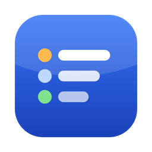
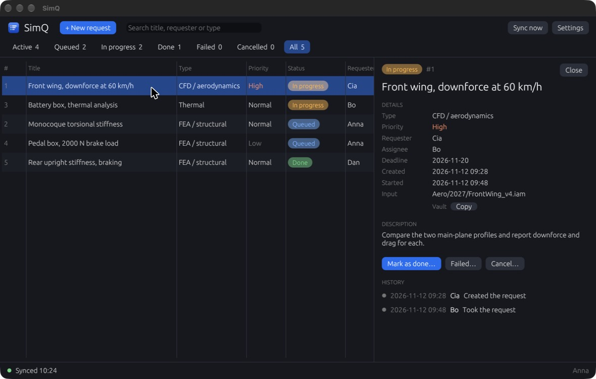

<p align="center">
  
</p>

<h1 align="center">SimQ</h1>

<p align="center">
  <strong>The queue for your team's simulation requests.</strong><br>
  A small desktop app for Formula Student teams that keeps track of which simulations are needed,
  who is doing them, and where the input, report and results are.
</p>

<p align="center">
  <a href="https://github.com/Olsn-Dev/simq/actions/workflows/release.yml"></a>
</p>



- **No server.** The team syncs through a private GitHub repository or a shared folder.
- **Works offline.** Changes are sent when the network is back.
- **No clashes.** If two people take the same request at the same time, everyone ends up with the same winner.
- **Swedish and English.** Each person chooses their own language.
- **A single file** for Windows, macOS and Linux. Nothing to install.

**Contents:** [How it works](#how-it-works) · [Get started with GitHub](#get-started-with-github) · [Shared folder](#get-started-with-a-shared-folder-alternative) · [Download](#download-and-start) · [Good to know](#good-to-know) · [For developers](#for-developers)

SimQ does not run any simulations. You do the actual work as usual in Ansys, SolidWorks, Fusion or whatever you use. SimQ is only the queue and the notice board.

There is no server of its own. The app on your computer syncs with everyone else's in one of two ways:

- **GitHub (recommended):** a private GitHub repository and a shared team key. Team members only need the app and the key.
- **Shared folder:** an ordinary folder synced by, for example, Google Drive for desktop.

## How it works

1. Someone adds a need ("New request").
2. Someone else sees it in the queue and clicks "Take request".
3. When the simulation is done they click "Mark as done" and fill in where the report and the results are, plus a short summary.
4. Everyone on the team sees the same list and can open the report and results from there.

The app never stores any files for you. It only saves a link or a description of where the file is:

| Kind | What you fill in |
| --- | --- |
| Google Drive | A link starting with `http://` or `https://` |
| Vault | A short description, e.g. `Uprights/v3/Assembly.iam` |
| Other | Free text, e.g. `The USB stick in the workshop drawer` |

## Get started with GitHub

### One person sets it up (once)

1. **Create a private repository** on GitHub, e.g. `simq-data`. Tick "Add a README file" so the repository is not completely empty. Use the repository only for this.
2. **Create an access token** that only applies to that repository: GitHub → Settings → Developer settings → Personal access tokens → Fine-grained tokens → Generate new token.
   - Repository access: **Only select repositories** and choose `simq-data`.
   - Permissions → Repository permissions → **Contents: Read and write**.
   - Choose an expiry date. When the token expires you have to create a new one and hand it out again.
3. **Put the team key together:** `owner/repo:token`, for example `myteam/simq-data:github_pat_…`.
4. **Share the team key with the team** in a private channel.

The team key is a password to the queue. Anyone who has it can read and change everything in the repository. Never put it in a public repository, on a web page or in a public chat. GitHub also revokes tokens it finds in public repositories. If the key gets out: delete it on GitHub and create a new one.

### Every team member

1. Download the app from **Releases** and start it (see below about the warning the first time).
2. Choose language, type your display name, choose **GitHub** and paste the team key.
3. Click **Start**.

You do not need a GitHub account of your own, or any other program.

Tip: if you put a text file called `simq-teamkey.txt` containing the team key in the same folder as the app, the key is filled in automatically at first start. Then all that is left is typing your name.

## Get started with a shared folder (alternative)

1. Install Google Drive for desktop from <https://www.google.com/drive/download/> and sign in.
2. One person creates a folder called **SimQ** in Google Drive and shares it with the team. Everyone needs **edit access**.
3. Everyone adds the folder to their own Drive: open it under "Shared with me", right-click and choose **Organise → Add shortcut**. If Drive runs in streaming mode: right-click the folder in Explorer/Finder and choose **Offline access → Available offline**.
4. Start the app, choose **Shared folder**, click "Choose folder…" and point to the **SimQ** folder.

## Download and start

Get the latest version for your system under **Releases** on the GitHub page:

- **Windows:** unpack the zip file and double-click `SimQ.exe`.
- **macOS:** open the `.dmg` file and drag `SimQ` to Applications.
- **Linux:** unpack the `tar.gz` file and run `./simq`.

The app is a single self-contained file. Nothing needs to be installed.

The first time, you choose language (**Svenska** or **English**), display name and how the app should sync. Each person chooses their own language, and the team can mix freely. Everything can be changed later under **Settings**.

### The app is not signed

We have no developer certificate, so both Windows and macOS warn the first time you start the app.

**Windows (SmartScreen):** When the "Windows protected your PC" box appears, click **More info** and then **Run anyway**.

**macOS (Gatekeeper):** Try to open the app once (you get a message that it cannot be opened). Then go to **System Settings → Privacy & Security**, scroll down and click **Open Anyway** next to SimQ. On older macOS it is enough to right-click the app and choose **Open**. You only need to do this once.

If it still does not work on macOS you can remove the quarantine flag in Terminal:

```bash
xattr -dr com.apple.quarantine /Applications/SimQ.app
```

## Good to know

### It takes a moment before other people's changes show up

The app looks for news every 15 seconds, when the window gets focus and when you click **Sync now**. With GitHub, other people's changes normally show up within half a minute. With a shared folder, Drive also needs time, so expect a few seconds up to a minute. The status bar at the bottom shows when the app last synced.

### "Someone got there first"

Because there is a delay, two people can take the same request almost at the same time. Then the one who was first wins. Every app works out the same winner, regardless of the order in which the changes arrive.

The one who lost gets a box along the lines of: *"Anna took the request before you, so your change does not apply. The request is in progress (Anna)."* Your change stays in the request's history, marked as rejected, but it does not affect the request.

### Offline

You can keep working as usual. Changes are saved on your computer and sent when the network is back. With GitHub the status bar shows "No contact with GitHub, showing saved data" and how many changes are waiting to be sent.

With a shared folder: if the folder itself disappears (e.g. if Google Drive is not running) the status bar shows "Folder not found, showing saved data". Then you can read everything that has already synced, but not make changes until the folder is back.

### Never touch the files in `ops/`

The repository (or the shared folder) has a folder `ops/` with one small file per event (request created, request taken and so on). **Never edit, move or delete those files by hand.** The whole list is derived from them, and the app itself never changes or deletes a file that already exists. If you remove a file, requests can disappear or change status for everyone.

A request cannot be edited afterwards either. If something went wrong: cancel the request and add a new one.

### Backup

- **GitHub:** the repository has full history. Every event is its own commit, so nothing disappears by mistake.
- **Shared folder:** Google Drive keeps version history and has a bin. Feel free to zip the whole folder now and then and keep it somewhere else.

### If something looks odd

Under **Settings → Diagnostics** you can see the number of events, the last sync, how many changes are waiting to be sent, files that could not be read and events that were rejected. The **Rebuild cache** button empties the app's local database and reads everything again. It is harmless: the database is only a copy.

If you see "GitHub denied access", the team key has probably expired. Ask whoever set up the repository for a new one and paste it under Settings.

If you see "A new version of the app is available" or "Update the app", someone on the team has a newer version. Download the latest from Releases.

## For developers

The app is written in Rust with [egui](https://github.com/emilk/egui). SQLite is built into the binary.

```bash
cargo run --release
```

```bash
cargo test
```

Several instances on the same computer (for testing) are started with a configuration folder each:

```bash
cargo run --release -- --config-dir /tmp/simq-a
```

A new release is built automatically for Windows, macOS and Linux when a tag starting with `v` is pushed:

```bash
git tag v0.1.0 && git push origin v0.1.0
```

The app icon is drawn by a script. To change it, edit `tools/make_icon.py` and run it (requires Pillow):

```bash
python3 tools/make_icon.py
```

Keep the app's source code in a different repository from the team's data, and never put the team key in the source code.

### How the sync works

- Every change is a new file: `ops/YYYY-MM/<time>-<counter>_<client>_<id>.json`. No files are overwritten, so the content can never conflict.
- Every app replays all events in a fixed order (hybrid logical clock, then client ID and event ID) and builds its own local SQLite cache. The same files always give the same result.
- With GitHub the app works against a local copy of `ops/`, and a background thread keeps the copy and the repository equal through the GitHub REST API: new files in the repository are downloaded, new local files are uploaded as one commit each. The team key is stored in plain text in the app's settings file on the computer.
- Everything coming from outside is treated as untrusted input: files over 64 KiB, broken JSON, unknown fields and files with the wrong name or path are ignored. Only `http://` and `https://` links can be clicked.

The code is in `src/`: `model` (types), `hlc` (clock), `ops` (file format), `replay` (state machine), `store` (cache), `sync` (folder reading and background thread), `github` (sync with a repository), `config`, `i18n` (Swedish/English), `theme` (look and feel) and `ui`.
