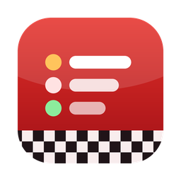
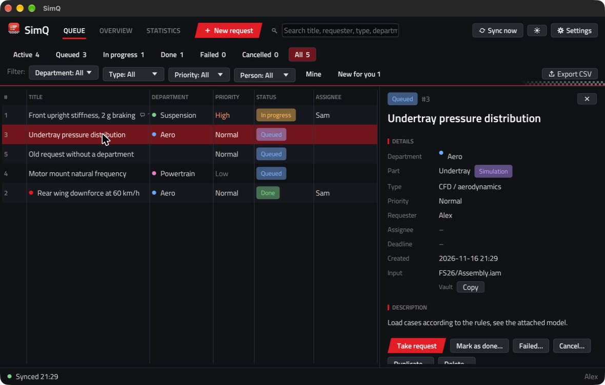
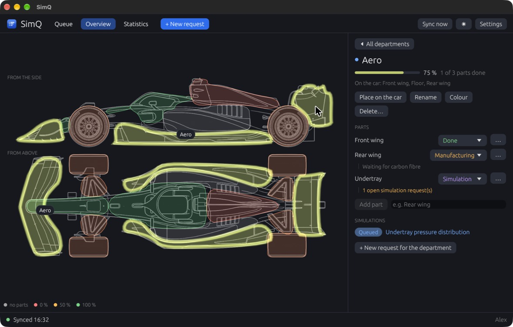

<p align="center">
  
</p>

<h1 align="center">SimQ</h1>

<p align="center">
  <strong>The queue for your team's simulation requests.</strong><br>
  A small desktop app for Formula Student teams that keeps track of which simulations are needed,
  who is doing them, and where the input, report and results are.
</p>

<p align="center">
  <a href="https://github.com/Olsn-Dev/simq/actions/workflows/release.yml"></a>
</p>



- **The car at a glance.** An overview page shows a drawing of the car where every department marks its zones and tracks its parts.
- **Departments, filters and comments.** See who asks for what, filter the queue and discuss a request where it lives.
- **Files included.** Upload CAD files and reports through the app, or just link to where they are.
- **No server.** The team syncs through a private GitHub repository or a shared folder.
- **Works offline.** Changes are sent when the network is back.
- **No clashes.** If two people take the same request at the same time, everyone ends up with the same winner.
- **Swedish and English.** Each person chooses their own language.
- **Small and self-contained** for Windows, macOS and Linux: an installer on Windows, a disk image on macOS.

**Contents:** [How it works](#how-it-works) · [The overview](#the-overview) · [Get started with GitHub](#get-started-with-github) · [Shared folder](#get-started-with-a-shared-folder-alternative) · [Download](#download-and-start) · [Updating](#updating) · [Good to know](#good-to-know) · [For developers](#for-developers)

SimQ does not run any simulations. You do the actual work as usual in Ansys, SolidWorks, Fusion or whatever you use. SimQ is only the queue and the notice board.

There is no server of its own. The app on your computer syncs with everyone else's in one of two ways:

- **GitHub (recommended):** a private GitHub repository and a shared team key. Team members only need the app and the key.
- **Shared folder:** an ordinary folder synced by, for example, Google Drive for desktop.

## How it works

1. Someone adds a need ("New request").
2. Someone else sees it in the queue and clicks "Take request".
3. When the simulation is done they click "Mark as done" and fill in where the report and the results are, plus a short summary.
4. Everyone on the team sees the same list and can open the report and results from there.

For every file (input, report, results) you choose how to point to it. You can upload the file through the app, or just save a link or a description of where it is:

| Kind | What you fill in |
| --- | --- |
| Google Drive | A link starting with `http://` or `https://` |
| Vault | A short description, e.g. `Uprights/v3/Assembly.iam` |
| Other | Free text, e.g. `The USB stick in the workshop drawer` |
| Upload file | Choose a file on your computer (at most 500 MB). Everyone on the team can then download it from the request |

### Departments, filters and comments

- **Department and part.** A new request can say which department asks for it and which part of the car it is about. Both are optional.
- **Filters.** Above the queue you can filter on department, simulation type, priority and person, show only your own requests, and search. Click a column heading to sort by it; click again to reverse, and a third time to go back to the usual order. Filters and sorting are yours alone and are not synced.
- **Comments.** Open a request and write at the bottom of it. Questions and answers stay with the request.
- **New for you.** A blue dot marks your own requests (the ones you created or took) that someone else has changed or commented on since you last opened them. The "New for you" filter shows only those.
- **Duplicate.** A request cannot be edited, but **Duplicate…** opens a new one filled in from it.
- **Export CSV.** Saves the list as it is shown, for Excel or a meeting. The file uses semicolons between the columns.
- **Room for the request.** When a request is open beside the queue, the least important columns are hidden instead of cut off. They come back when you close it.
- **Shortcuts.** Ctrl+N (⌘N on a Mac) starts a new request, Ctrl+F goes to the search field, Ctrl+1, 2 and 3 switch between Queue, Overview and Statistics, and Esc closes what is open.
- **It remembers.** The window size and position, the column widths, the page you were on, the tab and the filters are kept between starts.

## The overview



The **Overview** page shows a drawing of a formula car, from the side and from above. It is there to make the state of the car easy to see.

1. **Add a department.** A department works like a folder. Type a name under "New department", or click **Add suggestions** to get Aero, Chassis, Suspension, Powertrain and Electronics, already placed on the car. Everything can be changed afterwards.
2. **Place it on the car.** Click the parts of the car that belong to the department: front wing, nose, front suspension, front wheels, monocoque and cockpit, sidepods, floor, engine cover, rear suspension, rear wheels and rear wing. Each part follows the shape of the car and is the same part in both views. A department can have several parts, and a part belongs to one department at a time. Click a part again to remove it, then **Save**. A new department goes straight to this step.
3. **Add its parts.** Each part in the list has a status: Not started, Design, Simulation, Manufacturing or Done. Change it as the work moves on. A part can also have a short note.

The colour of a department's shapes shows how far its parts have come, from red over amber to green. A red badge with a number shows how many simulation requests the department has open. Grey means the department has no parts yet. Point at a shape to light up everything that belongs to the same department, in both views. Click it to open the department. From there you can also create a simulation request for the department or for one part, and see its open requests. A click between the shapes does nothing.

Team members on a version older than 0.5.1 do not see departments that are placed on the car until they update. Zones drawn as rectangles in version 0.5.0 are no longer shown: place those departments again.

The **Statistics** page counts requests per status, department, simulation type and assignee, and shows the average wait and lead time.

## Get started with GitHub

### One person sets it up (once)

1. **Create a private repository** on GitHub, e.g. `simq-data`. Tick "Add a README file" so the repository is not completely empty. Use the repository only for this.
2. **Create an access token** that only applies to that repository: GitHub → Settings → Developer settings → Personal access tokens → Fine-grained tokens → Generate new token.
   - Repository access: **Only select repositories** and choose `simq-data`.
   - Permissions → Repository permissions → **Contents: Read and write**.
   - Choose an expiry date. When the token expires you have to create a new one and hand it out again.
3. **Put the team key together:** `owner/repo:token`, for example `myteam/simq-data:github_pat_…`.
4. **Share the team key with the team** in a private channel.

The team key is a password to the queue. Anyone who has it can read and change everything in the repository. Never put it in a public repository, on a web page or in a public chat. GitHub also revokes tokens it finds in public repositories. If the key gets out: delete it on GitHub and create a new one.

### Every team member

1. Download the app from **Releases** and start it (see below about the warning the first time).
2. Choose language, type your display name, choose **GitHub** and paste the team key.
3. Click **Start**.

You do not need a GitHub account of your own, or any other program.

Tip: if you put a text file called `simq-teamkey.txt` containing the team key in the same folder as the app, the key is filled in automatically at first start. Then all that is left is typing your name.

## Get started with a shared folder (alternative)

1. Install Google Drive for desktop from <https://www.google.com/drive/download/> and sign in.
2. One person creates a folder called **SimQ** in Google Drive and shares it with the team. Everyone needs **edit access**.
3. Everyone adds the folder to their own Drive: open it under "Shared with me", right-click and choose **Organise → Add shortcut**. If Drive runs in streaming mode: right-click the folder in Explorer/Finder and choose **Offline access → Available offline**.
4. Start the app, choose **Shared folder**, click "Choose folder…" and point to the **SimQ** folder.

## Download and start

Get the latest version for your system under **Releases** on the GitHub page:

- **Windows:** run the `-setup.exe` installer. It installs SimQ for your user only, without administrator rights, and adds a Start menu shortcut and an uninstaller. There is also a zip file with just `SimQ.exe` if you prefer not to install.
- **macOS:** open the `.dmg` file and drag `SimQ` to Applications.
- **Linux:** unpack the `tar.gz` file and run `./simq`.

The app is a single self-contained program. Nothing else needs to be installed.

The first time, you choose language (**Svenska** or **English**), display name and how the app should sync. Each person chooses their own language, and the team can mix freely. Everything can be changed later under **Settings**.

The app follows the computer's light or dark mode. The sun and moon button at the top right switches between them, and **Settings → Appearance** has all three choices.

### The app is not signed

We have no developer certificate, so both Windows and macOS warn the first time you start the app.

**Windows (SmartScreen):** When the "Windows protected your PC" box appears, click **More info** and then **Run anyway**.

**macOS (Gatekeeper):** Try to open the app once (you get a message that it cannot be opened). Then go to **System Settings → Privacy & Security**, scroll down and click **Open Anyway** next to SimQ. On older macOS it is enough to right-click the app and choose **Open**. You only need to do this once.

If it still does not work on macOS you can remove the quarantine flag in Terminal:

```bash
xattr -dr com.apple.quarantine /Applications/SimQ.app
```

## Updating

The app looks for a newer version every time it starts. When there is one, an **Update to …** button appears at the top right. Click it, wait for the download, and click **Restart**. You can also look manually under **Settings → Check for updates**.

The update is downloaded from this repository's Releases page. For that to work the repository must be public, or the team key must also be allowed to read it (Contents: Read-only). On macOS the app has to be in a folder you can write to, such as Applications, not opened straight from the disk image.

## Good to know

### It takes a moment before other people's changes show up

The app looks for news every 15 seconds, when the window gets focus and when you click **Sync now**. With GitHub, other people's changes normally show up within half a minute. With a shared folder, Drive also needs time, so expect a few seconds up to a minute. The status bar at the bottom shows when the app last synced.

### "Someone got there first"

Because there is a delay, two people can take the same request almost at the same time. Then the one who was first wins. Every app works out the same winner, regardless of the order in which the changes arrive.

The one who lost gets a box along the lines of: *"Anna took the request before you, so your change does not apply. The request is in progress (Anna)."* Your change stays in the request's history, marked as rejected, but it does not affect the request.

### Offline

You can keep working as usual. Changes are saved on your computer and sent when the network is back. With GitHub the status bar shows "No contact with GitHub, showing saved data" and how many changes are waiting to be sent.

With a shared folder: if the folder itself disappears (e.g. if Google Drive is not running) the status bar shows "Folder not found, showing saved data". Then you can read everything that has already synced, but not make changes until the folder is back.

### Never touch the files in `ops/`

The repository (or the shared folder) has a folder `ops/` with one small file per event (request created, request taken and so on). **Never edit, move or delete those files by hand.** The whole list is derived from them, and the app itself never changes or deletes a file that already exists. If you remove a file, requests can disappear or change status for everyone.

A request cannot be edited afterwards either. If something went wrong: duplicate the request, correct the copy and delete the original. Departments and parts are different: their names, zones and statuses can be changed at any time, and the latest change wins.

### Uploaded files

Choose **Upload file** as the kind for the input when you create a request, or for the report and results when you mark it as done. Whoever takes the request opens it and clicks **Download** to save the file to their computer.

- A file can be at most 500 MB. Zip large assemblies first.
- With GitHub the files are stored under **Releases** in the team's data repository (releases named `simq-files-…`), not in the repository itself. Never edit or delete those releases by hand.
- Uploading happens in the background and is queued if you are offline. Until an upload has finished, others who try to download are asked to try again in a moment.
- Everyone with the team key can download every file.
- Every download is checked against a checksum, so a damaged or altered file is never saved. The app never opens or runs the files.
- Team members on a version older than 0.4.0 do not see requests that use uploaded files until they update.

### Deleting a request

Open the request and click **Delete…**. The request disappears from the list for everyone on the team, and this cannot be undone. Anyone with the team key can delete. Nothing is removed from the repository: the deletion is just another event, and deleted requests are listed under **Settings → Diagnostics**.

Team members on a version older than 0.3.0 still see deleted requests until they update.

Uploaded files that belonged only to deleted requests can be removed under **Settings → Diagnostics → Clean up the files…**. That removes them for everyone and cannot be undone.

### Backup

- **GitHub:** the repository has full history. Every event is its own commit, so nothing disappears by mistake.
- **Shared folder:** Google Drive keeps version history and has a bin. Feel free to zip the whole folder now and then and keep it somewhere else.

### If something looks odd

Under **Settings → Diagnostics** you can see the number of events, the last sync, how many changes are waiting to be sent, files that could not be read and events that were rejected. The **Rebuild cache** button empties the app's local database and reads everything again. It is harmless: the database is only a copy.

If you see "GitHub denied access", the team key has probably expired. Ask whoever set up the repository for a new one and paste it under Settings.

If you see "A new version of the app is available" or "Update the app", someone on the team has a newer version. Download the latest from Releases.

## For developers

The app is written in Rust with [egui](https://github.com/emilk/egui). SQLite is built into the binary.

```bash
cargo run --release
```

```bash
cargo test
```

Several instances on the same computer (for testing) are started with a configuration folder each:

```bash
cargo run --release -- --config-dir /tmp/simq-a
```

A new release is built automatically for Windows, macOS and Linux when a tag starting with `v` is pushed:

```bash
git tag v0.1.0 && git push origin v0.1.0
```

The car on the overview page is `assets/car.png`: white line art on a transparent background, tinted by the app for light and dark mode. The clickable parts are outlines traced over it in `src/ui/car.rs`, in the picture's own pixel coordinates.

The Windows installer is built from `installer/simq.iss` with Inno Setup by the release workflow.

The look is set in `src/theme.rs`: racing red on carbon grey, slanted primary buttons and the [Titillium Web](https://fonts.google.com/specimen/Titillium+Web) typeface (SIL Open Font License, see `assets/fonts/OFL.txt`). The button icons are drawn by `tools/make_icons.py`.

The app icon is drawn by a script. To change it, edit `tools/make_icon.py` and run it (requires Pillow):

```bash
python3 tools/make_icon.py
```

Keep the app's source code in a different repository from the team's data, and never put the team key in the source code.

### How the sync works

- Every change is a new file: `ops/YYYY-MM/<time>-<counter>_<client>_<id>.json`. No files are overwritten, so the content can never conflict.
- Departments, parts and comments are events in the same log. Setting a department or a part replaces its content, so the latest event in the order wins; deleting one is final.
- Every app replays all events in a fixed order (hybrid logical clock, then client ID and event ID) and builds its own local SQLite cache. The same files always give the same result.
- With GitHub the app works against a local copy of `ops/`, and a background thread keeps the copy and the repository equal through the GitHub REST API: new files in the repository are downloaded, new local files are uploaded as one commit each. The team key is stored in plain text in the app's settings file on the computer.
- Everything coming from outside is treated as untrusted input: files over 64 KiB, broken JSON, unknown fields and files with the wrong name or path are ignored. Only `http://` and `https://` links can be clicked.

The code is in `src/`: `model` (types), `hlc` (clock), `ops` (file format), `replay` (state machine), `store` (cache), `sync` (folder reading and background thread), `github` (sync with a repository), `blobs` (uploaded files), `export` (CSV and statistics), `config`, `i18n` (Swedish/English), `theme` (look and feel), `update` (in-app update) and `ui` (with `ui/overview` and `ui/car` for the car and `ui/stats`).

## Licence

SimQ is released under the [MIT licence](LICENSE). The Titillium Web typeface in `assets/fonts` has its own licence, the SIL Open Font License (`assets/fonts/OFL.txt`).
